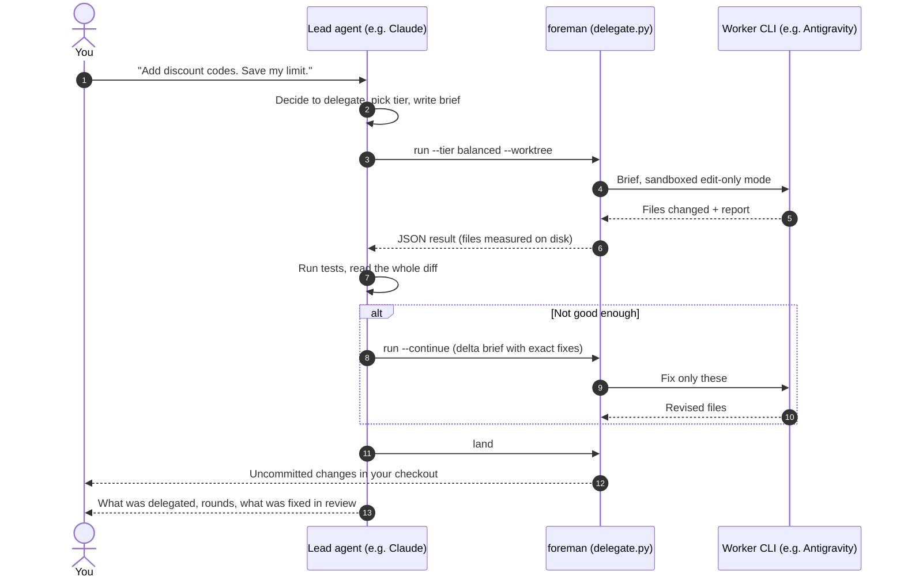

<div align="center">


# Foreman

**Make your best model the lead engineer. Let the AI coding agents you already pay for do the typing.**

[](https://github.com/Ahsuu27488/foreman/actions/workflows/test.yml)


[](LICENSE)

[Why](#why-foreman) · [How it works](#how-it-works) · [Quick start](#quick-start) · [Tiers and effort](#tiers-and-effort) · [Supported CLIs](#supported-worker-clis) · [Commands](#command-reference) · [FAQ](#faq)

</div>

---

Foreman is an [Agent Skill](https://agentskills.io) and Claude Code plugin. When a task is clear,
checkable and big enough to be worth it, your lead agent writes a brief and hands it to a worker CLI
such as **Google Antigravity, OpenAI Codex, Cursor, GitHub Copilot or Gemini CLI**. Then it does what
a good lead engineer does: runs your tests, reads every changed line, and accepts the work, sends it
back with precise fixes, or escalates. Nothing reaches you that the lead would not have signed off on
had it written the code itself.

Your expensive model spends its limits on **judgment**. The workers spend their quotas on **volume**.

## Why Foreman

You probably pay for more than one AI coding tool, and most of them sit idle while your main
agent burns through its usage limit typing boilerplate, tests and mechanical refactors.

| Without Foreman | With Foreman |
|---|---|
| The lead model writes every line itself | The lead writes a brief; a worker writes the code |
| Session limits run out on routine work | Routine work runs on the worker's quota |
| Other subscriptions sit unused | Antigravity, Codex, Cursor and others pull their weight |
| Sub-agent output is trusted blindly | Every result is tested and reviewed before it lands |
| Edits land straight in your checkout | Workers edit an isolated git worktree; you get clean, uncommitted changes |

In testing, a Gemini 3.8 Flash worker built a strict spec-driven parser that passed 53 of 53 hidden
tests. The whole job used about 2% of a Google AI Pro five-hour quota and no Claude tokens.

## How it works



1. **Decide.** The lead keeps tiny edits, design calls, subtle debugging and anything touching
   secrets or payment processing. Clear, verifiable, larger tasks get delegated.
2. **Pick a tier and effort.** `light`, `balanced` or `frontier`, at a matching reasoning effort.
3. **Brief.** Goal, scope, requirements, edge cases, and the exact test command, checked first.
4. **Dispatch.** The worker runs headless and sandboxed in its own git worktree. If it is missing
   or out of quota, the next worker on the route takes over.
5. **Review.** The lead runs your gates and reads every changed file. It never trusts the
   worker's self-report.
6. **Land.** Accepted work arrives in your checkout as uncommitted changes. Workers never commit,
   and the lead commits only when you want it to.

### A real session

From the end-to-end test that shaped version 0.4:

> **Lead:** delegated "discount codes" (9 requirements) to Gemini 3.8 Flash on the balanced tier.
> **Round 1:** 16 tests passed, but review found speculative code: unused aliases, dead fallbacks,
> dict/tuple handling for cases that cannot happen. Sent back with five exact fixes.
> **Round 2:** all five fixed, 60 clean lines, tests still green. Accepted and landed as
> uncommitted changes. Claude usage: the brief and the review. Worker usage: free.

## Quick start

**1. Install the plugin** (Claude Code):

```bash
claude plugin marketplace add Ahsuu27488/foreman
claude plugin install foreman@foreman
```

Using another agent that supports Agent Skills? Copy `plugins/foreman/skills/foreman/` into its
skills folder.

**2. Set it up once.** In a Claude Code session, say:

> run foreman doctor and init

Claude finds your worker CLIs, sorts their models into tiers, writes
`~/.config/foreman/config.json`, and shows you the routes to confirm.

**3. Use it.** Ask for work the way you normally would, and add a hint when you care about limits:

> Write unit tests for every public function in `src/utils/dates.py`. Save my Claude limit on this one.

Foreman also triggers on "delegate", "offload", "hand this off", "use Gemini" or "use Codex".

## Tiers and effort

Most vendors ship a light, a balanced and a frontier model. Foreman matches the tier to how hard
the task is to get right, not how big it is.

| Tier | For | Typical models | Default effort |
|---|---|---|---|
| `light` | Renames, formatting, docstrings, search and summaries | Haiku, Flash-Lite, mini, nano | `low` |
| `balanced` | Features from a spec, unit tests, focused refactors, known bug fixes | Sonnet, Flash, standard GPT | `medium` |
| `frontier` | Cross-module changes, tricky algorithms, concurrency, escalations | Opus, Pro, Max, top GPT tier | `high` |

- **Effort** maps to each CLI's own flag (`agy --effort`, `claude --effort`, Codex's
  `model_reasoning_effort`). It is clamped to the levels a CLI supports, and never overrides a
  model id that already names an effort, such as `flash-high`.
- **Escalation is cheap.** First raise the effort, then move up a tier. After two failed rounds the
  lead does the work itself.
- `delegate.py models` lists each CLI's models with a suggested tier. Details:
  [model-tiers.md](plugins/foreman/skills/foreman/references/model-tiers.md).

## Supported worker CLIs

| CLI | Backend | Edit mode | Read-only | Effort flag | Status |
|---|---|---|---|---|---|
| Google Antigravity | `agy` | `--mode accept-edits --sandbox` | enforced | yes | ✅ Verified end to end |
| Gemini CLI | `gemini` | `--approval-mode auto_edit` | enforced | no | Flags checked |
| OpenCode | `opencode` | `--agent build` | isolated | no | Flags checked |
| OpenAI Codex | `codex` | `--sandbox workspace-write` | enforced | yes | From docs |
| Cursor Agent | `cursor` | `--force` | isolated | no | From docs |
| GitHub Copilot CLI | `copilot` | `--allow-tool write` | isolated | no | From docs |
| Qwen Code | `qwen` | `--approval-mode auto-edit` | isolated | no | From docs |
| Factory Droid | `droid` | `--auto low` | isolated | no | From docs |
| Amp | `amp` | default | isolated | no | From docs |
| Aider | `aider` | default | isolated | no | From docs |
| Goose | `goose` | default | isolated | no | From docs |
| Crush | `crush` | default | isolated | no | From docs |
| Continue | `continue` | `--auto` | isolated | no | From docs |
| Claude Code | `claude` | `--permission-mode acceptEdits` | enforced | yes | From docs, off by default |

**Isolated** means the CLI cannot promise not to write, so read-only runs happen in a throwaway git
worktree. Any other headless agent CLI can be added in your config without code changes; see
[backends.md](plugins/foreman/skills/foreman/references/backends.md). Ran one of the "from docs"
backends successfully? Please [tell us](CONTRIBUTING.md#verifying-a-backend).

## Command reference

The lead agent runs these for you. They are listed here so you know what happens.

| Command | What it does |
|---|---|
| `delegate.py doctor` | Shows installed worker CLIs, versions, verification status and your routes |
| `delegate.py models [backend]` | Lists a CLI's models with a suggested tier |
| `delegate.py init [--lead X]` | Writes your config, with one route per tier, leaving the lead's own CLI out |
| `delegate.py run --brief F --cwd D` | Runs one task. Options: `--tier`, `--worker backend:model@effort`, `--effort`, `--worktree`, `--readonly`, `--continue`, `--timeout` |
| `delegate.py land --workdir W` | Brings accepted worktree changes into your checkout, uncommitted; `--commit -m` to commit |
| `delegate.py discard --workdir W` | Removes a worktree and its branch without landing anything |

Example config for a Claude Code lead with a Google AI Pro plan:

```json
{
  "lead": "claude",
  "routes": {
    "light": ["agy:gemini-3.8-flash-low"],
    "balanced": ["agy:gemini-3.8-flash-high"],
    "frontier": ["agy:claude-opus-4-6-thinking", "gemini:gemini-3.1-pro-preview"]
  },
  "tier_effort": {"light": "low", "balanced": "medium", "frontier": "high"}
}
```

## Safety and privacy

- **Sandboxed workers.** Each CLI runs in its own edit-only or read-only mode. Foreman never enables
  "skip all permissions" modes.
- **Isolated edits.** Workers write to a separate git worktree. Your checkout changes only when the
  lead runs `land`, and only as uncommitted changes unless you asked for a commit.
- **Your data goes where your worker goes.** Briefs, and the files a worker reads, go to that
  worker's vendor through its own CLI. Foreman makes no network requests of its own and has no
  telemetry. Some free tiers train on prompts, so keep secrets out of briefs.
- Full disclosure of what runs and what is written: [plugin README](plugins/foreman/README.md).
  Security reports: [SECURITY.md](SECURITY.md).

## FAQ

**Does it work on claude.ai or in Cowork?**
No. Foreman runs worker CLIs on your machine, so it needs Claude Code on your computer.

**Does it really save usage?**
Yes, for the right tasks. The lead spends tokens on the brief and the review instead of on writing
and iterating. For a few-line edit, briefing costs more than doing it, so the lead keeps those.

**What if the worker gets it wrong?**
The lead reviews every result against your tests and the brief, sends precise fixes back, and
escalates or takes over after two failed rounds. You are told what was fixed.

**Can the lead be Codex or Gemini instead of Claude?**
Yes. The skill is written for any agent that supports Agent Skills. `init` leaves the lead's own CLI
out of the routes, because delegating to it would spend the same plan.

**Windows, macOS, Linux?**
All three. CI runs the suite on each, on Python 3.10 and 3.13.

## Project layout

```
.claude-plugin/marketplace.json      marketplace entry
plugins/foreman/
  .claude-plugin/plugin.json         plugin manifest
  README.md                          directory listing and disclosure
  assets/logo.svg, logo.png
  evals/                             trigger-accuracy cases for `claude plugin eval`
  skills/foreman/
    SKILL.md                         what the lead agent reads
    references/                      briefs, review, tiers, backends
    scripts/delegate.py              dispatcher (standard library only)
    scripts/backends.json            built-in worker definitions
tests/                               unit and integration tests with a fake worker CLI
```

## Contributing

Bug reports, verified backends and new CLI definitions are welcome. See
[CONTRIBUTING.md](CONTRIBUTING.md). Run the tests with `python -m unittest discover -s tests`.

## License

[MIT](LICENSE) © 2026 Muhammad Ahsan
